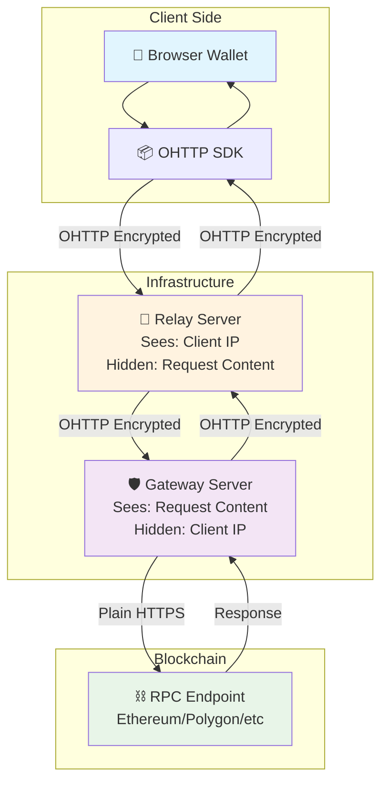
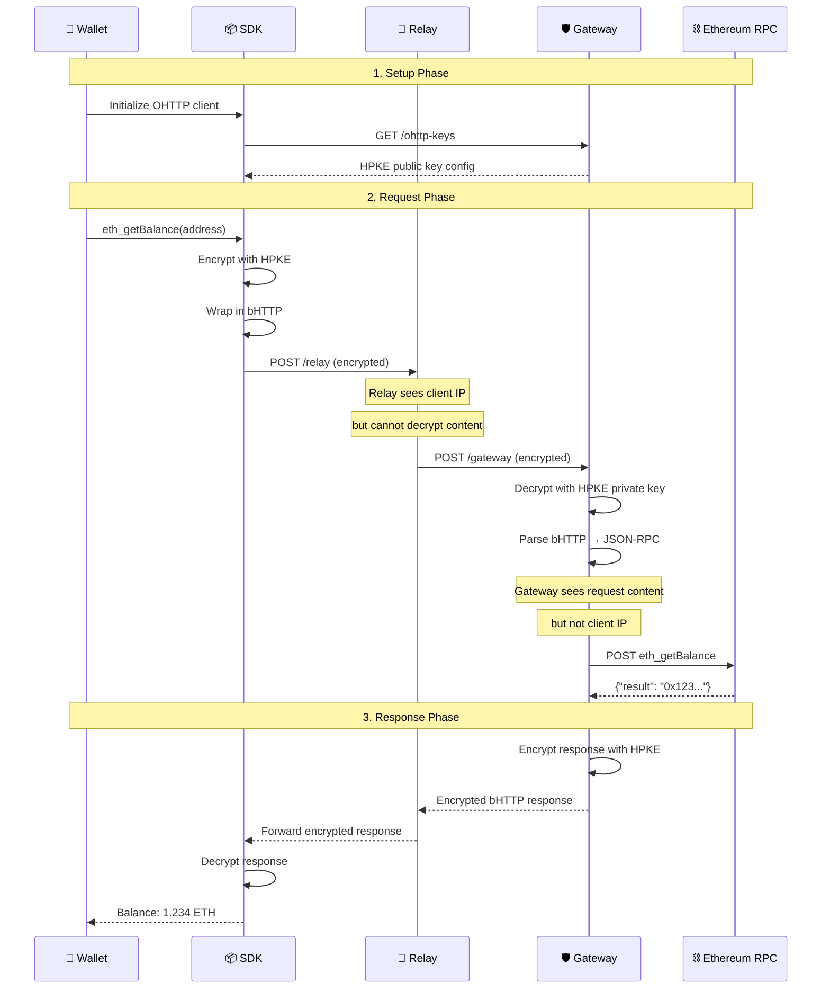
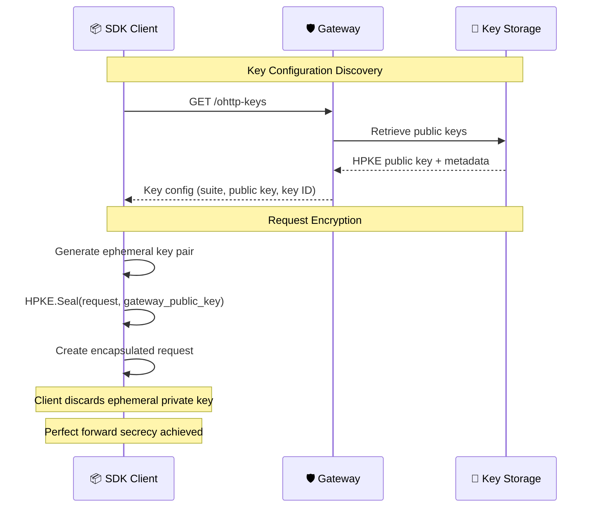
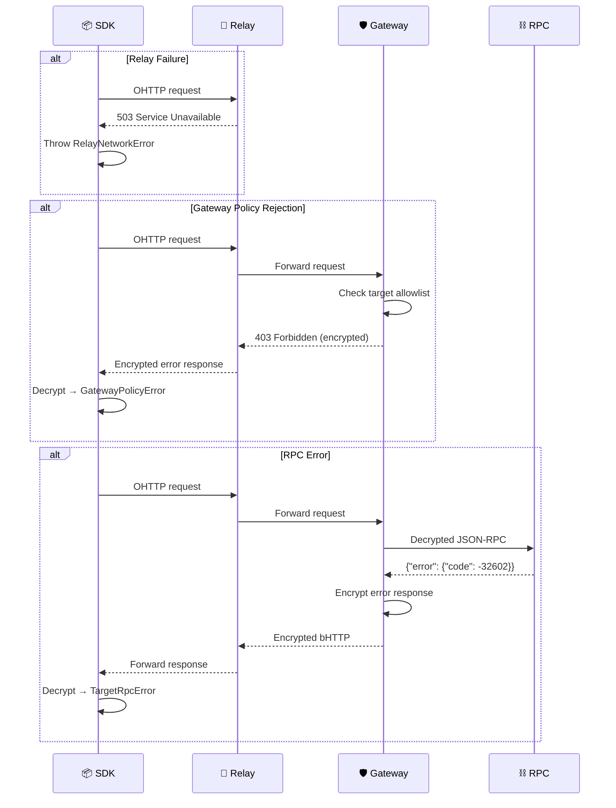
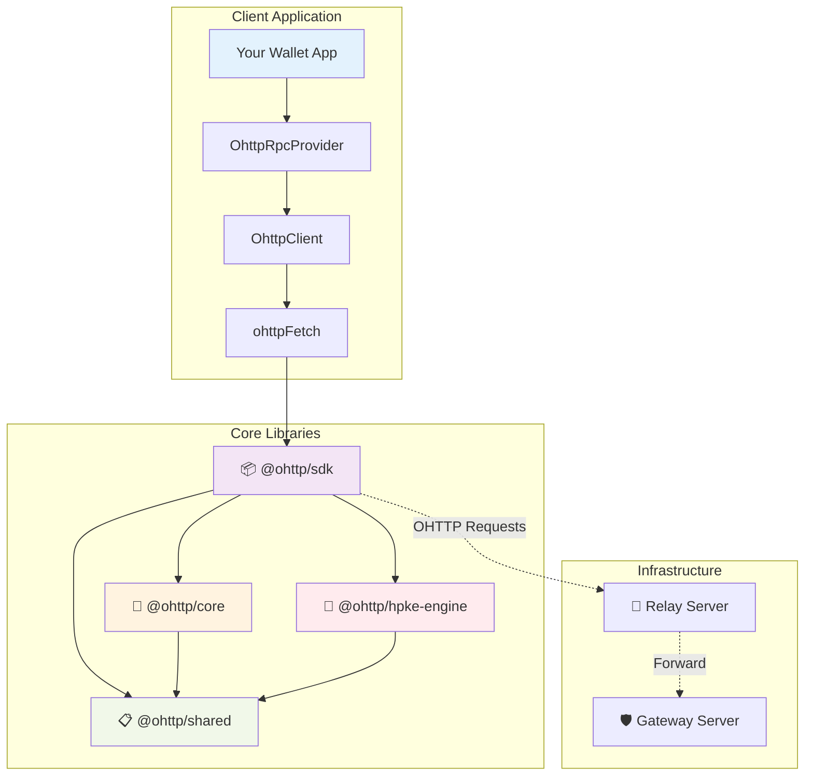
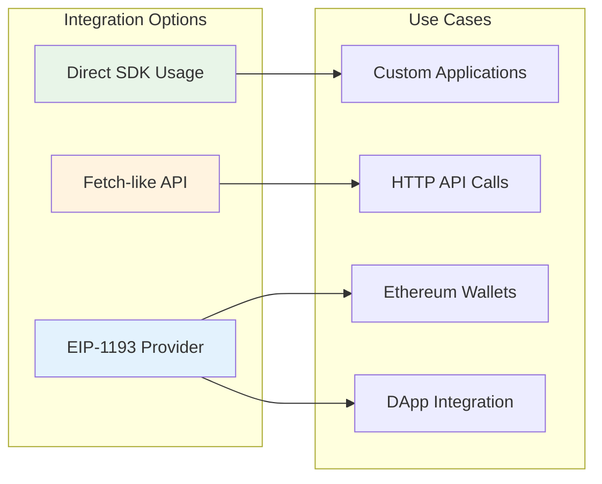
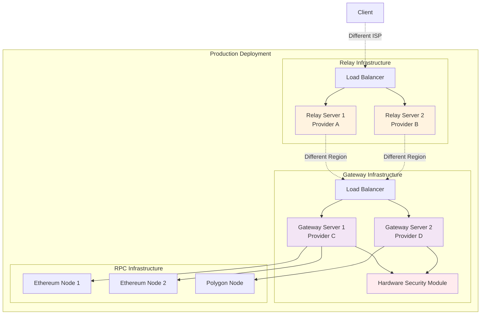
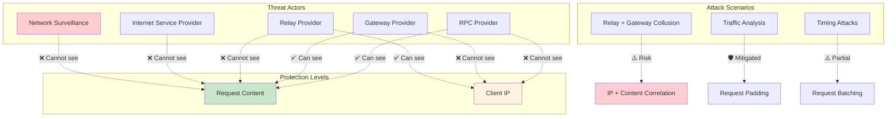
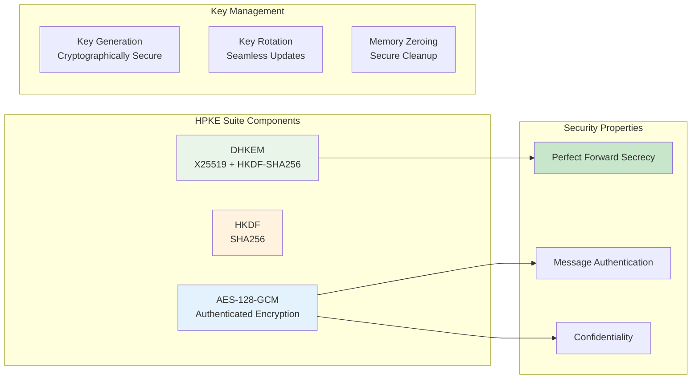

# OHTTP-RPC

[](https://www.typescriptlang.org/)
[](https://bun.sh/)
[](#license)
[](#testing)
[](https://datatracker.ietf.org/doc/rfc9458/)

> **⚠️ EXPERIMENTAL SOFTWARE - NOT AUDITED**
> 
> This is experimental software that has not undergone security audits. It is provided for research, development, and educational purposes only. **DO NOT USE IN PRODUCTION** without proper security review and auditing. The cryptographic implementations may contain vulnerabilities, and the privacy guarantees depend on correct implementation and deployment.
>
> - 🔬 **Experimental**: Implementation may change significantly
> - 🚨 **Unaudited**: No formal security review has been conducted  
> - 🧪 **Research Purpose**: Intended for development and testing
> - ⚖️ **No Warranty**: Use at your own risk
>
> For production use, ensure proper security auditing of all cryptographic components.

A comprehensive TypeScript implementation of **Oblivious HTTP (OHTTP)** for anonymizing blockchain RPC requests, enabling privacy-preserving interactions with Ethereum and other blockchain networks.

## 🏗️ Architecture Overview

This project implements a **three-party privacy model** for blockchain RPC requests, ensuring no single entity can correlate client identity with request content:



### 🔐 Privacy Guarantees

- **🔍 Network Surveillance**: Observers see encrypted traffic to relay, cannot read content
- **🏢 Relay Provider**: Sees your IP address but cannot decrypt your requests
- **🛡️ Gateway Provider**: Decrypts requests but doesn't know your identity
- **⛓️ RPC Provider**: Receives requests from gateway, not your IP

## 🔄 Protocol Flow

### Complete Request Flow



### Key Exchange Flow



### Error Handling Flow



## 📦 Architecture

### Core Packages

- `@ohttp/shared` - Common types and constants
- `@ohttp/hpke-engine` - HPKE cryptographic operations (WebCrypto implementation)
- `@ohttp/core` - bHTTP encoding/decoding and OHTTP message framing
- `@ohttp/sdk` - Client SDK with OhttpClient, ohttpFetch, OhttpRpcProvider
- `@ohttp/test-utils` - Testing utilities and mock servers

### Applications

- `apps/relay` - Stateless OHTTP relay server (Bun)
- `apps/gateway` - OHTTP gateway with policy enforcement (Bun)

### Component Interaction



## Quick Start

### Installation

```bash
bun install
```

### Easy Deployment

Deploy both gateway and relay servers with one command:

```bash
# Generate secure keys
bun run generate-keys

# Deploy with Docker (recommended)
bun run deploy:docker

# Or deploy natively
bun run deploy:native
```

### Manual Setup

For more control over configuration:

```bash
# Setup gateway
bun run setup:gateway
bun run validate:gateway

# Setup relay  
bun run setup:relay
bun run validate:relay

# Start services
cd apps/gateway && bun run start
cd apps/relay && bun run start
```

### Building & Testing

Build and test the working components:

```bash
bun run build
```

This validates:
- ✅ **bHTTP encoding/decoding** (RFC 9292) - Binary HTTP message format
- ✅ **OHTTP message framing** (RFC 9458) - Oblivious HTTP protocol implementation  
- ✅ **HPKE cryptographic operations** - Hybrid Public Key Encryption
- ✅ **Complete type system** - Full TypeScript definitions
- ✅ **Mock RPC server** - Testing infrastructure
- ✅ **SDK components** - Client libraries and utilities

### Testing

Run the core functionality tests:

```bash
bun test
```

## 💡 Usage Examples

### Integration Patterns



### Viem Integration (Recommended)

Drop-in replacement for `http()` transport:

```typescript
import { createPublicClient } from 'viem'
import { mainnet } from 'viem/chains'
import { ohttp } from '@ohttp/sdk/viem'

const client = createPublicClient({
  chain: mainnet,
  transport: ohttp('https://mainnet.infura.io/v3/YOUR_KEY')
})

// Use normally - full type safety and privacy!
const balance = await client.getBalance({ address: '0x...' })
```

### Wagmi Integration

Same pattern for React apps:

```typescript
import { createConfig } from 'wagmi'
import { mainnet } from 'wagmi/chains'
import { ohttp } from '@ohttp/sdk/wagmi'

export const config = createConfig({
  chains: [mainnet],
  transports: {
    [mainnet.id]: ohttp('https://mainnet.infura.io/v3/YOUR_KEY')
  }
})

// All existing hooks work the same!
function MyComponent() {
  const { data: balance } = useBalance({ address: '0x...' })
  return <div>Balance: {balance?.formatted}</div>
}
```

### EIP-1193 Provider

```typescript
import { OhttpRpcProvider } from "@ohttp/sdk";

// Create OHTTP-enabled RPC provider
const provider = new OhttpRpcProvider({
  gatewayKeyConfigUrl: "https://gateway.example.com/ohttp-keys",
  relayUrl: "https://relay.example.com/relay",
  targetRpcUrl: "https://mainnet.infura.io/v3/YOUR_PROJECT_ID",
});

// Use like any EIP-1193 provider
const chainId = await provider.request({ method: "eth_chainId" });
```

### Direct OHTTP Fetch

```typescript
import { ohttpFetch } from "@ohttp/sdk";

const response = await ohttpFetch(
  "https://gateway.example.com/ohttp-keys", // Gateway key config
  "https://relay.example.com/relay",        // Relay URL
  "https://api.example.com/data",           // Target URL
  {
    method: "POST",
    headers: { "content-type": "application/json" },
    body: JSON.stringify({ query: "data" }),
    paddingBytes: 64,
  }
);

const result = await response.json();
```

## 🚀 Deployment

For detailed deployment instructions, see [DEPLOYMENT.md](./DEPLOYMENT.md).

### Quick Commands

```bash
# Generate secure keys
bun run generate-keys

# Setup services interactively
bun run setup:gateway
bun run setup:relay

# Validate configuration
bun run validate:gateway
bun run validate:relay

# Deploy with Docker
bun run deploy:docker

# Deploy natively
bun run deploy:native
```

### Environment Files

- `apps/gateway/env.example` - Gateway configuration template
- `apps/relay/env.example` - Relay configuration template  
- `docker.env.example` - Docker Compose environment template

### Deployment Notes

**Docker Limitations:**
- ⚠️ Docker containers may have WebCrypto limitations on some platforms
- Native deployment with Bun is recommended for full crypto support
- If using Docker, test thoroughly on your target platform

## ⚙️ Configuration

### Deployment Architecture



### Relay Server

Environment variables:

```bash
RELAY_PORT=8787
GATEWAY_URL=https://gateway.example.com/gateway
ALLOWED_ORIGINS=https://wallet.example.com,https://localhost:5173
MAX_BODY_BYTES=1048576
CONNECT_TIMEOUT_MS=3000
TOTAL_TIMEOUT_MS=15000
```

### Gateway Server

Environment variables:

```bash
GATEWAY_PORT=8788
HPKE_SEED=your-secure-base64url-encoded-32-byte-seed
ALLOWED_TARGETS=https://mainnet.infura.io,https://eth.llamarpc.com
ALLOWED_HEADERS=content-type,accept,authorization
MAX_INNER_BYTES=524288
UPSTREAM_CONNECT_TIMEOUT_MS=3000
UPSTREAM_TOTAL_TIMEOUT_MS=15000
```

## 📝 Logging Configuration

The OHTTP-RPC system includes a comprehensive logging system with separate controls for production and test environments.

### Production Logging

Control production logging with these environment variables:

```bash
# Log levels: error, warn, info, debug, trace
LOG_LEVEL=info

# Output format: text (default) or json
LOG_FORMAT=text

# Enable/disable timestamps (default: true)
LOG_TIMESTAMP=true

# Enable/disable context information (default: true)
LOG_CONTEXT=true
```

**Examples:**
```bash
# Production with minimal logging
LOG_LEVEL=error LOG_FORMAT=json bun run dev:gateway

# Development with verbose logging
LOG_LEVEL=debug bun run dev:gateway

# JSON format for log aggregation
LOG_LEVEL=info LOG_FORMAT=json bun run start
```

### Test Logging

Tests run **completely silently by default** (no log output). Use `TEST_LOG_LEVEL` to control test logging:

```bash
# Test log levels: silent (default), error, warn, info, debug
TEST_LOG_LEVEL=silent    # No output (default)
TEST_LOG_LEVEL=error     # Only errors
TEST_LOG_LEVEL=warn      # Warnings and errors
TEST_LOG_LEVEL=info      # Info, warnings, and errors  
TEST_LOG_LEVEL=debug     # All output including debug
```

**Test Scripts:**
```bash
# Silent tests (default - only pass/fail)
bun test
bun run test:silent

# Tests with info logging
bun run test:verbose

# Tests with debug logging
bun run test:debug

# Integration tests with logging
bun run test:integration:verbose
```

### Separate Production vs Test Logging

You can run different log levels for production code vs tests:

```bash
# Production code at debug level, tests silent
LOG_LEVEL=debug TEST_LOG_LEVEL=silent bun test

# Production code at info level, tests with errors only
LOG_LEVEL=info TEST_LOG_LEVEL=error bun run dev:gateway & bun test
```

### Component-Specific Logging

The logger automatically tags output by component:

```
[2024-01-15T10:30:45.123Z] INFO  [gateway] HPKE keys initialized
[2024-01-15T10:30:45.124Z] INFO  [relay] Server running port=8787
[2024-01-15T10:30:45.125Z] DEBUG [ohttp-client] Encapsulating request method=POST
```

## 🔒 Security Considerations

### Threat Model Analysis



### Privacy Model

- **Traffic Analysis Protection**: Request size is padded and content is encrypted
- **IP Anonymization**: Relay sees IP but not content; Gateway sees content but not IP
- **Administrative Separation**: Deploy relay and gateway under different domains/accounts

### Cryptographic Implementation



**Cryptographic Details:**
- **HPKE Suite**: DHKEM(X25519, HKDF-SHA256) + HKDF-SHA256 + AES-128-GCM
- **Key Rotation**: Gateway supports multiple keys for seamless rotation  
- **Memory Safety**: Sensitive key material is zeroized after use
- **Forward Secrecy**: Each request uses ephemeral keys

### Policy Enforcement

- **Target Allowlisting**: Gateway only forwards to approved RPC endpoints
- **Header Filtering**: Only allowlisted headers are forwarded to prevent deanonymization
- **Size Limits**: Configurable limits prevent DoS attacks

## 🔧 Troubleshooting

### Common Issues

**Gateway fails to start with crypto errors:**
- Ensure you're using a secure HPKE seed: `bun run generate-keys`
- Try native deployment instead of Docker
- Verify WebCrypto support on your platform

**Relay cannot connect to gateway:**
- Check `GATEWAY_URL` in relay configuration
- Verify gateway is running and accessible
- Test connectivity: `curl http://gateway-host:8788/health`

**CORS errors in browser:**
- Update `ALLOWED_ORIGINS` in relay configuration
- Ensure origins include protocol (https://)
- Test preflight: `curl -X OPTIONS -H "Origin: https://yourapp.com" http://relay:8787/relay`

**Configuration validation fails:**
- Run validation tools: `bun run validate:gateway`, `bun run validate:relay`
- Check environment variables are properly set
- Verify file permissions on `.env` files

### Health Endpoints

Monitor service health:
```bash
# Gateway health and metrics
curl http://localhost:8788/health
curl http://localhost:8788/metrics

# Relay health
curl http://localhost:8787/health

# OHTTP key configuration
curl http://localhost:8788/ohttp-keys.json
```

## Protocol Standards

This implementation follows these RFCs:

- **RFC 9458**: Oblivious HTTP (OHTTP)
- **RFC 9292**: Binary HTTP (bHTTP) 
- **RFC 9180**: Hybrid Public Key Encryption (HPKE)